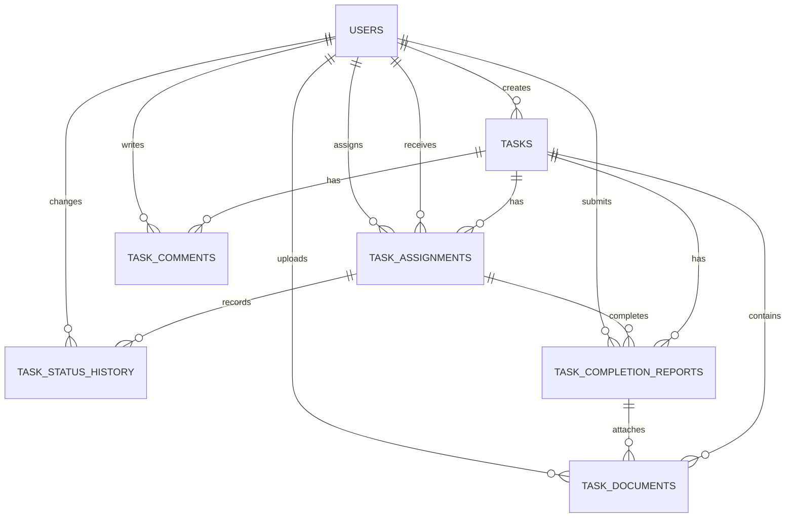

# Architecture and database

## System overview

```text
React/Vite browser ─┐
                    ├── HTTPS + JSON/JWT ── Express API ── PostgreSQL
Expo/React Native ──┘                         │
                                              └── Supabase Storage (private bucket)
```

The API is a layered monolith organized into Routes, Controllers, and Database layers. Routes declare HTTP endpoints, validation, and middleware; controllers translate HTTP requests and responses; the database layer owns the PostgreSQL connection and repository operations. Shared authentication and error-handling middleware live separately from these three layers.

```text
backend/src/
  routes/       HTTP endpoints and request validation
  controllers/  HTTP handlers and orchestration
  database/     PostgreSQL connection and feature repositories
  services/     external file storage integration
  middlewares/  authentication, authorization, validation, errors
  utils/        shared errors, logging, and response helpers
```

`authenticate` validates each JWT against the current active user record, and role middleware restricts administrator-only operations.

Example request flow: `routes/tasks.routes.js` validates a request and calls `controllers/tasks.controller.js`; the controller calls `database/tasks.repository.js`; repositories execute parameterized SQL and keep multi-query writes transactional. `routes/index.js` mounts feature routes and the health endpoint under `/api`.

## Backend feature areas

- `auth`: registration, login, and current-user lookup.
- `users`: administrator directory, user lookup, account activation/deactivation.
- `tasks`: scoped task list, creation, update, soft deletion, and filtering.
- `assignments`: multiple active assignees, transitions, and revocation.
- `history`: append-only status/revocation history retrieval.
- `comments`: task discussion with author/admin mutation rules.
- `documents`: private task documents and assignment-specific completion reports; metadata is stored in PostgreSQL and file bytes in Supabase Storage.

Each feature's HTTP routes and controller are kept in the shared `routes/` and `controllers/` layers, while its SQL repository is in `database/`.

The web and mobile clients use the same `/api` contract. The web app stores the JWT in browser local storage; the mobile app stores it with Expo SecureStore. Both clients enforce role-aware presentation, while access control remains enforced by the API.

## Web client MVC structure

```text
web/src/
  App.jsx                    Application entry point
  models/apiModel.js         Shared API data-access model and HTTP client
  controllers/
    WorkspaceController.jsx  Workspace state, effects, and user actions
  components/                Reusable interface elements (pagination)
  features/
    auth/                    Authentication views
    tasks/                   Task list, filters, and detail views
    team/                    Administrator team view
    profile/                 User profile view
    workspace/               Workspace shell and composition view
  main.jsx                   React entry point and global styles
```

The browser client follows MVC adapted to React: `apiModel.js` owns HTTP data access, `WorkspaceController.jsx` coordinates application state and actions, and feature components render the views. `App.jsx` only mounts the controller. Views receive data and callbacks through props; authorization and business rules remain enforced by the API.

## Database model

| Table | Purpose |
|---|---|
| `users` | Accounts, role, active state, bcrypt password hash |
| `tasks` | Task metadata, creator, due date, soft-delete timestamp |
| `task_assignments` | Assignee-specific status, active/revoked state, completion and revocation metadata |
| `task_status_history` | Status transitions and revocation events |
| `task_comments` | Task discussion, author, edit and soft-delete timestamps |
| `task_completion_reports` | Optional note for each assignment completion cycle |
| `task_documents` | Task/report file metadata and private storage object path |
| `schema_migrations` | Applied migration names and timestamps |



Important constraints include unique user email, role/priority/status enums, one active assignment per task/user pair, and mutually consistent completion/revocation metadata. Task and assignment removal cascades their report/file metadata; user references are restricted to preserve attribution. Migrations are ordered SQL files in `database/migrations`; the runner records successfully applied names so repeated runs are safe.

Task-level status is derived from active assignments: no active assignees means `unassigned`; all `todo` means `todo`; all `completed` means `completed`; otherwise (including a mix of `todo` and `completed`) it is `in_progress`. Deactivating a user does not automatically revoke their existing assignment; that assignment remains active, contributes to task status, and must be revoked by an admin if it should no longer count.

## Authorization summary

| Operation | Admin | Employee |
|---|---|---|
| List users | Yes | No |
| List tasks | All non-deleted tasks | Created by or actively assigned to the user |
| Create a task | Yes; may provide active assignee IDs | Yes; API assigns it to its creator |
| Edit a task | Yes | Task creator |
| Soft-delete a task | Yes | No |
| Assign/revoke users | Yes | No |
| Change assignment status | Any active assignment | Own active assignment only |
| Upload task documents | Yes | Task creator |
| Read task documents/reports | Any accessible task | Task creator or active assignee |
| Upload completion report files | Any active completed assignment | Own active completed assignment |
| Read task comments/history | Any task | Task creator or active assignee |
| Create/edit/delete comment | Any accessible task; admin can moderate | Accessible task; author may edit/delete own comment |

Authorization is checked server-side; hiding a control in either client is not a security boundary.

## Operational boundaries

- JWT expiry defaults to seven days; signing requires `JWT_SECRET`.
- Password hashing uses bcrypt (12 rounds).
- Database and secrets are configured via environment variables, never committed `.env` files.
- Health check `GET /api/health` requires a working database connection.
- Production CORS must be restricted with `WEB_ORIGIN`.
- `SUPABASE_URL`, `SUPABASE_SERVICE_ROLE_KEY`, and `SUPABASE_STORAGE_BUCKET` configure a private file bucket; service-role credentials stay on the API only. The API returns 2-minute signed URLs only after checking task access.
